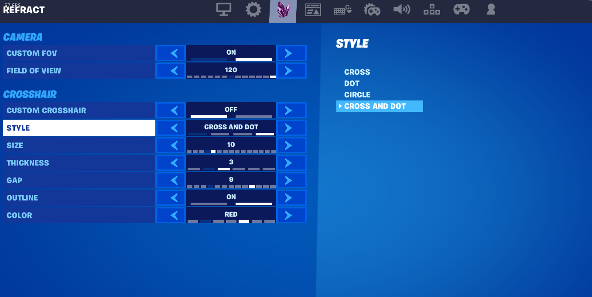

# ogfn-custom-settings

Adds your own tab to the Fortnite settings menu, with real settings rows that look and work like the game's own (sliders, arrows, option bars, the description panel on the right).

The example tab has a camera section (custom FOV, with a 60 to 120 slider), a building section (building and editing sensitivity sliders, 10% to 500% of your normal look sensitivity, like current Fortnite's build and edit mode multipliers) and a crosshair section (style, size, thickness, gap, outline, color). Values save to `%LOCALAPPDATA%\Refract\client.ini` and load again next launch.

## 19.10 only

This only works on 19.10 (`++Fortnite+Release-19.10-CL-18675304`). It calls engine functions directly by address and reads class fields by offset, and those values were pulled out of the 19.10 exe with IDA and an SDK dump. Every build moves them around, so on any other version they point at the wrong thing. The code checks the exe timestamp first and does nothing if it isn't 19.10.

If you want it on another version you'll have to find every address and offset again for that build.

## How it works

- Hooks the settings registry so a Refract collection gets built and registered next to the game's own ones
- Each row gets a data source that reads and writes the values in `CustomSettings.h`
- When the options menu opens it adds a new tab using one of the game's existing tab layouts, and points that tab at the Refract collection
- The tab icon is a PNG built into the DLL (`TabIcon.h`), loaded as a texture at runtime
- Custom FOV hooks `GetFOVAngle` on the local camera manager and scales the result, so ADS zoom still works
- Building and editing sensitivity scale the player controller's `InputYawScale` / `InputPitchScale` while you hold the building or editing tool, and put the game's values back when you switch to anything else

It's written as a drop-in for Tellurium. See [GUIDE.md](GUIDE.md) for setup.

## Credits

Built on [Tellurium](https://github.com/plooshi/Tellurium) by Sarah (plooshware). Tellurium is the redirect / SSL bypass DLL this plugs into, all credit to her for it.
